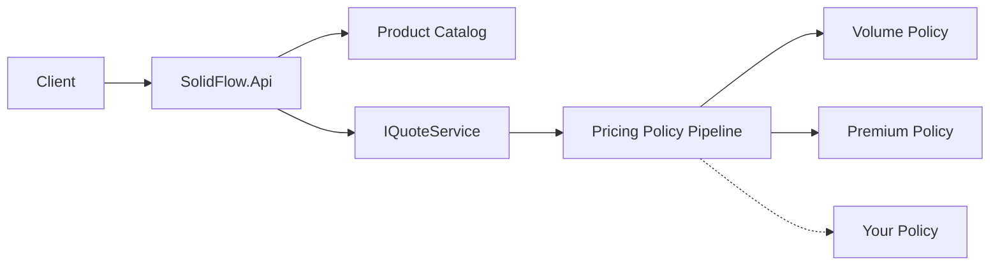

<div align="center">

# SolidFlow

### Policy-driven pricing, designed to change without breaking.

[](https://github.com/lcarlini/SOLID/actions/workflows/ci.yml)
[](https://dotnet.microsoft.com/)
[](LICENSE)

A compact .NET reference implementation of SOLID design in a realistic
pricing domain. Add customer, volume, or campaign rules without rewriting the
quote engine.

**[Explore SOLID →](https://lcarlini.github.io/SOLID/)** — a short, visual walkthrough of the five principles using this project as the example.

</div>

## Why SolidFlow?

Pricing logic changes constantly. A growing chain of conditionals makes every
new promotion riskier than the last. SolidFlow models each pricing rule as an
independent policy and composes those policies through dependency injection.

The repository is intentionally small enough to understand in one sitting,
while retaining the engineering practices expected from a maintainable
service: domain boundaries, validation, automated tests, static analysis,
versioned HTTP endpoints, CI, and dependency updates.

## Architecture



Project responsibilities:

- `SolidFlow.Core` — domain model, policy contracts, and quote orchestration.
- `SolidFlow.Api` — HTTP boundary, composition root, and sample product catalog.
- `SolidFlow.Core.Tests` — behavioral coverage for pricing and extensibility.

### SOLID in practice

- **Single responsibility** — quote orchestration, catalog lookup, and pricing
  rules have separate reasons to change.
- **Open/closed** — new discounts implement `IPricingPolicy`; the quote service
  remains untouched.
- **Liskov substitution** — every policy follows the same side-effect-free
  evaluation contract.
- **Interface segregation** — consumers depend on focused contracts such as
  `IQuoteService` and `IProductCatalog`.
- **Dependency inversion** — the API composes abstractions at startup instead
  of constructing business dependencies inside endpoints.

## Run locally

Prerequisite: [.NET 10 SDK](https://dotnet.microsoft.com/download).

```bash
dotnet restore
dotnet test
dotnet run --project src/SolidFlow.Api --launch-profile http
```

Create a quote:

```bash
curl -X POST http://localhost:5025/api/v1/quotes \
  -H "Content-Type: application/json" \
  -d '{
    "customerId": "8a8b2d9c-52d8-44d5-a9c2-623ae33cc234",
    "customerTier": "Premium",
    "items": [
      { "sku": "ARCH-BOOK", "quantity": 10 },
      { "sku": "REVIEW-KIT", "quantity": 1 }
    ]
  }'
```

Useful endpoints:

- `GET /api/v1/health`
- `GET /api/v1/products`
- `POST /api/v1/quotes`

## Add a pricing policy

Implement the focused contract:

```csharp
public sealed class CampaignPolicy : IPricingPolicy
{
    public PriceAdjustment? Evaluate(
        PricingContext context,
        decimal currentTotal)
    {
        // Return null when the campaign does not apply.
        return new("CAMPAIGN", "Launch campaign", currentTotal * 0.05m);
    }
}
```

Register it in the API composition root:

```csharp
builder.Services.AddSingleton<IPricingPolicy, CampaignPolicy>();
```

No changes to `QuoteService` or existing policies are required.

## Quality gates

Every pull request restores, builds with warnings treated as errors, runs the
test suite, and publishes Cobertura coverage as a workflow artifact.
Dependabot checks NuGet and GitHub Actions dependencies monthly.

## Contributing

Small, focused pull requests are welcome. See [CONTRIBUTING.md](CONTRIBUTING.md)
for the local quality checks and contribution workflow.

## License

Distributed under the [MIT License](LICENSE).
